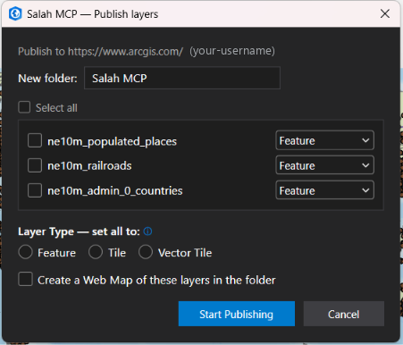
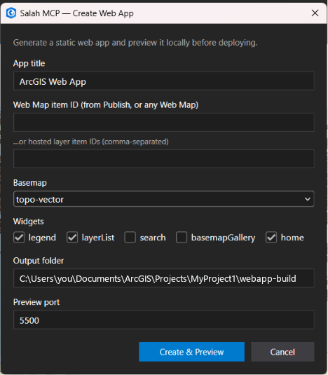
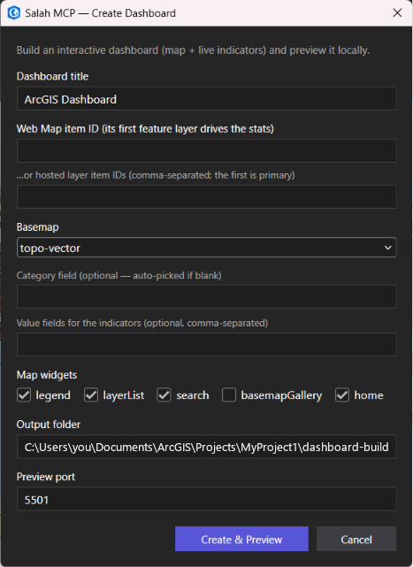
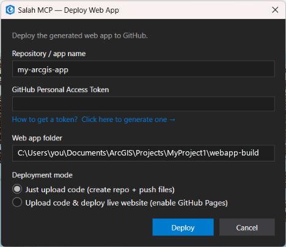

# ArcGIS Pro Salah MCP

**Drive the whole ArcGIS stack with natural language through any MCP agent
(Claude **or** Google Antigravity) — or with one click from an ArcGIS Pro ribbon.**

A four-layer [Model Context Protocol](https://modelcontextprotocol.io) server.
You describe what you want, and your agent calls the right ArcGIS operations — from
desktop geoprocessing, to publishing on ArcGIS Online, to a finished web app or
an interactive dashboard. Because it speaks the standard MCP stdio transport it is
**client-agnostic** — use it from Claude, Google Antigravity, or any other MCP
client. The same building blocks are also wired to a **Salah MCP ribbon** inside
ArcGIS Pro, so you can publish and build apps with no agent at all.

---

## About us

**ArcGIS Pro Salah MCP** is an independent integration that connects Esri's
ArcGIS platform to AI agents through the open Model Context Protocol. It is the
ArcGIS Pro sibling of [`qgis_salah_mcp`](https://github.com/Ahmed-salah-muhammed/qgis_salah_mcp):
same goal — let an assistant operate a full GIS end to end — but for Esri's
commercial stack instead of QGIS.

The vision is **one brain, four hands**: a single server that can analyze data in
ArcGIS Pro, publish it to ArcGIS Online, and turn it into a shareable web app or
dashboard — in one conversation, or one ribbon click.

- **Author:** Ahmed Salah Muhammed — [github.com/Ahmed-salah-muhammed](https://github.com/Ahmed-salah-muhammed)
- **License:** MIT
- **Not affiliated with Esri.** ArcGIS, ArcGIS Pro and ArcPy are trademarks of Esri.

---

## The four layers

| Layer | Prefix | Backend | What it does |
| --- | --- | --- | --- |
| **1 · Pro** | `pro_*` | ArcPy | Geoprocessing, one-call project context, geodatabase schema (domains/subtypes/attribute rules), topology validation, **GeoAI**, **Utility Network**, `.pyt` + ModelBuilder authoring |
| **1b · Live** | `live_*` | .NET add-in (loopback HTTP) | Drive the **open** ArcGIS Pro session (list/zoom/query/run GP/export) |
| **2 · Portal** | `portal_*` | ArcGIS API for Python | Publish layers to **ArcGIS Online / Portal**, manage items, build Web Maps |
| **3 · WebApp** | `webapp_*` | ArcGIS Maps SDK for JS **5.0** | Generate a static **web app** *or* an interactive **dashboard**, then deploy to GitHub |

**The signature workflow:** `Pro (analyze)` → `Portal (publish)` → `WebApp / Dashboard (visualize)` → `GitHub (deploy)`.

---

## Two ways to use it

1. **From an AI agent** — chat in natural language and the agent chains the
   `pro_*` / `portal_*` / `webapp_*` tools. Works with **any MCP client** —
   [Claude](https://claude.ai/download) **and [Google Antigravity](https://antigravity.google)**
   are both supported (the server speaks the standard MCP stdio transport, so it
   is client-agnostic). Best for analysis + automation.
2. **From the ArcGIS Pro ribbon** — the **Salah MCP** tab gives you one-click
   **Publish**, **Create Web App**, **Create Dashboard** and **Deploy Web App**
   buttons. No agent required; the buttons shell out to the same Python.

> **Status (v0.1):** Pro geoprocessing, project/layer & symbology tools, portal
> publishing (feature / **tile** / **vector tile**), web-map and **web-app +
> dashboard** generation (ArcGIS Maps SDK for JS **5.0** with Calcite + map
> components), and a one-click **GitHub deploy** are all implemented, plus a live
> `.NET` bridge (loopback, no token) with a **7-button Salah MCP ribbon**
> (add-in **v0.1.2**). Default portal is **ArcGIS Online**; the portal URL is
> configurable, so **Enterprise Portal** is a small next step.

---

## Why ArcGIS Pro needs a different design than QGIS

QGIS is open-source, so `qgis_salah_mcp` runs a Python socket server *inside* the
live QGIS session. ArcGIS Pro does **not** allow that: ArcPy works on
`.aprx`/`.gdb` files on disk and **cannot attach to a running Pro session** (an
Esri limitation). Driving the *live* session requires a **.NET add-in** built
with the ArcGIS Pro SDK. So this project pairs the **headless ArcPy** path
(`pro_*`) with a **live `.NET` bridge** (`live_*`): a loopback HTTP add-in that
runs inside the open Pro session. See
[`SalahAIBridge/`](SalahAIBridge/) and [`docs/PROTOCOL.md`](docs/PROTOCOL.md).

---

## Architecture

```
You (natural language)                ArcGIS Pro ribbon (Salah MCP tab)
        │                                        │
        ▼                                        ▼
   Claude Desktop                        one-click buttons shell out
        │  stdio                                 │ to arcgispro-py3
        ▼                                        ▼
   MCP Server (FastMCP)                 ← src/arcgis_pro_salah_mcp/server.py
        ├── pro_*     → ArcPy            (arcgispro-py3 interpreter, files on disk)
        ├── live_*    → HTTP (loopback)  → .NET add-in inside the OPEN Pro session
        ├── portal_*  → arcgis (Py API)  → ArcGIS Online / Portal
        └── webapp_*  → static generator → Maps SDK for JS 5.0 app / dashboard
                                              └─ optional → GitHub repo + Pages
```

See [`docs/ARCHITECTURE.md`](docs/ARCHITECTURE.md) for the full design.

---

## Getting started (tutorial)

### Prerequisites

- **ArcGIS Pro 3.x** (provides ArcPy via its bundled `arcgispro-py3` Python).
- For publishing: be **signed in** to ArcGIS Online / your portal in ArcGIS Pro.
- For the agent workflow: an **MCP client** — **Claude Desktop** *or* **Google
  Antigravity** (or any other MCP-capable client).
- For the ribbon buttons: build & install the **SalahAIBridge** add-in (below).

### Step 1 — Install the package into ArcGIS Pro's Python

The `pro_*`, `webapp_*` and the ribbon buttons run inside ArcGIS Pro's bundled
interpreter, so install the package there:

```bat
"C:\Program Files\ArcGIS\Pro\bin\Python\envs\arcgispro-py3\python.exe" -m pip install -e .
```

> The web-app and dashboard generators only need the package importable (no heavy
> deps). If pip can't write to `Program Files` without admin, it falls back to your
> **user site**, which `arcgispro-py3` reads automatically — that's fine. If you
> only want the generators (and not the full MCP server deps), use
> `… -m pip install -e . --no-deps`.

For the Portal layer, add the optional `arcgis` dependency:

```bat
"...\arcgispro-py3\python.exe" -m pip install -e ".[portal]"
```

> **Self-healing:** if the MCP server starts under the wrong Python, it locates
> `arcgispro-py3` (env override → common paths → registry) and re-executes itself
> there. See `bootstrap.py`.

### Step 2 — Install the Salah MCP ribbon

Build the add-in and install it so the **Salah MCP** tab appears in ArcGIS Pro:

1. Open `SalahAIBridge/SalahAIBridge.slnx` in **Visual Studio 2026** (with the
   ArcGIS Pro SDK), or build from a shell:
   ```bat
   dotnet build SalahAIBridge\SalahAIBridge.csproj
   ```
2. **Close ArcGIS Pro**, then double-click the built
   `SalahAIBridge\bin\Debug\net10.0-windows\SalahAIBridge.esriAddinX`.
3. Reopen ArcGIS Pro → the **Salah MCP** tab is on the ribbon.

> Verify the loaded build in **Project ▸ Add-In Manager** — the version should
> read **0.1.2**. Bump `Config.daml`'s `version` whenever you change the add-in.

### Step 3a — Use it from the ArcGIS Pro ribbon (no agent)

With a project open, layers in the map, and you signed in:

1. **Publish** → pick feature layers from the checklist, choose a type per layer
   (**Feature / Tile / Vector Tile**), optionally "Create a Web Map", and publish
   straight to your portal into a new folder (with data-derived metadata).
2. **Create Web App** → generate a static Maps SDK for JS app from a Web Map id
   (or layer ids) and preview it on `http://localhost`.
3. **Create Dashboard** → generate an interactive dashboard (map + live
   indicators + breakdown + a "features in view" list, with a Light/Dark toggle)
   and preview it.
4. **Deploy Web App** → push the previewed folder to a new GitHub repo and
   (optionally) enable GitHub Pages for a live URL.

### Step 3b — Use it from an MCP client (Claude **or** Antigravity)

The server speaks the **standard MCP stdio transport**, so the registration is the
same everywhere: point an `mcpServers` entry at the installed entry point. Pick
your client below — the JSON is identical, only the file it goes in differs.

**Claude Desktop** — edit `claude_desktop_config.json`
(Windows: `%APPDATA%\Claude\claude_desktop_config.json`):

```json
"mcpServers": {
    "arcgis-pro-salah": {
      "command": "C:\\Program Files\\ArcGIS\\Pro\\bin\\Python\\envs\\arcgispro-py3\\python.exe",
      "args": ["-m", "arcgis_pro_salah_mcp.server"]
    }
  }
```

**Google Antigravity** — open the Agent panel → **MCP servers** → **Edit raw
config** (`mcp_config.json`) and add the **same** block:

```json
{
  "mcpServers": {
    "arcgis_pro_salah": {
      "command": "C:\\Program Files\\ArcGIS\\Pro\\bin\\Python\\envs\\arcgispro-py3\\python.exe",
      "args": [
        "-m",
        "arcgis_pro_salah_mcp.server"
      ],
      "env": {
        "PYTHONPATH": "your\\path\\MCP\\ArcGIS Pro Salah MCP\\src" // enter your path
      }
    }
  }
}
```

Save, then reload the MCP servers in Antigravity — the `pro_*`, `live_*`,
`portal_*` and `webapp_*` tools appear in the agent's tool list, exactly as in
Claude. (Any [environment variable](#configuration-environment-variables) can go in
the `env` block; it's shown here on Antigravity but works for either client.)

> Always point `command` at the installed **entry point**
> (`arcgis-pro-salah-mcp.exe`), not at `server.py` — package-relative imports only
> resolve when the package is installed. The path is the same regardless of client.

Then build a sample geodatabase and try the end-to-end story (works the same from
Claude or Antigravity):

```bat
"...\arcgispro-py3\python.exe" demos\setup_sample.py
```

> **You:** "Buffer `sample.gdb/cities` by 50 km, publish the result to my ArcGIS
> Online as 'City Service Areas', build a web map, then generate a dashboard."

The agent (Claude or Antigravity) chains:

1. `pro_buffer("sample.gdb/cities", "sample.gdb/cities_buf", "50 Kilometers")`
2. `portal_connect(profile="agol")` → `portal_publish_layer("…cities_buf", "City Service Areas")` → item id
3. `portal_create_webmap("City Service Areas", [item_id])` → webmap id
4. `webapp_create_dashboard("City Service Areas", webmap_id=…)` → static dashboard

Serve any generated folder locally:

```bat
cd webapp-build && python -m http.server 5500
```

---

## Two ways to build an app: static vs. custom

Once your data is in the portal, there are **two routes** to a finished
application — pick by how much control you want. Both reference your published
data by its **Web Map / layer item‑id**, so the app inherits the symbology,
labeling and popups you published.

### 1) Static apps (generated) — the quick path

The `webapp_create` / `webapp_create_dashboard` tools (and the **Create Web App**
/ **Create Dashboard** ribbon buttons) emit an opinionated, no‑build static site
(ArcGIS Maps SDK for JS 5.0 + Calcite + map components). Give them a **Web Map
item‑id** (or layer item‑ids) and they wire up the map, widgets, indicators and
interactions for you. Fast, consistent, zero hand‑coding.

### 2) Custom apps (built with Claude) — your design & workflow

When you want **your own design, layout, branding, workflow and concept**, skip
the generator and just **describe the app to Claude**. Claude hand‑writes a
bespoke ArcGIS Maps SDK for JS 5.0 application around your published **item‑id** —
custom Calcite panels, charts, tools and interaction logic, exactly to your spec.

**Typical flow:**

1. **Publish** your data / web map (ribbon **Publish**, or `portal_publish_layer`
   + `portal_create_webmap`) and copy the **item‑id** from your portal.
2. In Claude, describe the app and hand it the item‑id, e.g.:

   > **You:** "Build a single‑page flood‑response app. Left: a Calcite panel with
   > a date slider and a 'shelters only' filter. Center: the map from Web Map
   > item‑id `a1b2c3…`. Right: a live count of affected buildings and a bar chart
   > by district that updates with the map extent. Dark theme, our logo in the
   > header. Use ArcGIS Maps SDK for JS 5.0."

3. Claude generates the full app (and can drop the files into a folder for you).
4. Preview it locally (`python -m http.server`), then deploy with **Deploy Web
   App** / `webapp_github_pipeline`.

> The static generators are the quick path; the custom route is the creative one —
> same published data (referenced by **item‑id**), unlimited UI/UX. You can also
> start from a generated app and ask Claude to restyle or extend it.

---

## The Salah MCP ribbon

Once the **SalahAIBridge** add-in is installed, a **Salah MCP** tab appears on
the ArcGIS Pro ribbon. It groups the seven buttons into three task areas — **Live
Bridge**, **ArcGIS Online**, and **Web App** — so the whole *analyze → publish →
visualize → deploy* workflow is one click away, no agent required. Every button
is always enabled: this is a local developer tool, so there is no sign-in,
API key or licensing gate in front of the ribbon.


| Button | Icon | Group | What it does |
| --- | --- | --- | --- |
| **Start / Stop Server** | green play | Live Bridge | Start/stop the loopback bridge so `live_*` tools can reach the open session |
| **Ping** | cyan gauge | Live Bridge | `GET /health` on the bridge and show the response |
| **Zoom to Layer** | amber magnifier | Live Bridge | Read-only: zoom the active view to the first visible feature layer's full extent |
| **Publish** | blue upload | ArcGIS Online | Publish chosen layers (Feature/Tile/Vector Tile) to your portal + optional Web Map |
| **Create Web App** | orange browser | Web App | Generate a static Maps SDK for JS app and preview it on localhost |
| **Create Dashboard** | indigo bar-chart | Web App | Generate an interactive dashboard and preview it on localhost |
| **Deploy Web App** | GitHub mark | Web App | Push the generated folder to GitHub and (optionally) enable Pages |

Icons are generated from the official [Calcite Design System](https://developers.arcgis.com/calcite-design-system/icons/)
set (plus GitHub's Octicons for the Deploy mark) — see `SalahAIBridge/Images/make_icons.py`.
(The **Zoom to Layer** icon ships as-is and is not produced by that script.)

The **Publish** and **Deploy** progress windows are minimizable / hideable (a
**Hide** button + taskbar), so long uploads can run in the background while you
keep working in Pro.

### Live Bridge — Start Server, Ping & Zoom to Layer

The **Start Server** button toggles the loopback HTTP bridge (port `2026`, no
token) that runs *inside* the open Pro session. Once it's up, the `live_*` tools
— and Claude / Antigravity over MCP — can list layers, zoom, query and run
geoprocessing against the map you're actually looking at.

| Start the bridge | Confirm it's alive (Ping) |
| --- | --- |
|  |  |

- **Start Server** flips to **Stop Server** while running and shows the bridge URL
  (`http://127.0.0.1:2026`). From here you "talk to Claude / Antigravity over MCP."
- **Ping** issues `GET /health` and prints the raw response — `HTTP 200 OK` with
  `{"ok":true,"data":"alive"}` means the bridge is reachable and the `live_*`
  layer is ready.
- **Zoom to Layer** is a quick, read-only "orient yourself" action: it zooms the
  active view to the full extent of the first visible feature layer in the map.
  It runs entirely in-process — no bridge, no MCP round-trip needed.

### ArcGIS Online — Publish

**Publish** uploads the layers you pick straight to the portal you're signed into
inside ArcGIS Pro — into a brand-new folder, with metadata derived from the data
itself.



- **New folder** — names the portal folder the items land in (e.g. `Salah MCP`).
- **Layer checklist** — tick the layers to publish (or **Select all**); set a
  **per-layer type** with the dropdown, or flip every layer at once with the
  **Layer Type** radios — **Feature**, **Tile**, or **Vector Tile**.
- **Create a Web Map of these layers** — optionally assembles a Web Map in the
  same folder, ready to feed straight into **Create Web App** / **Create Dashboard**.
- **Start Publishing** runs the upload; the progress window can be hidden so it
  keeps going in the background.

### Web App — Create Web App

**Create Web App** generates an opinionated, no-build static site (ArcGIS Maps SDK
for JS 5.0 + Calcite) from a Web Map item-id (or hosted layer ids) and previews it
locally before you deploy.



- **App title** — the header shown in the generated app.
- **Web Map item ID** (from Publish, or any Web Map) — the data source; or paste
  one or more **hosted layer item IDs** instead.
- **Basemap** — the base layer (e.g. `topo-vector`).
- **Widgets** — toggle **legend**, **layerList**, **search**, **basemapGallery**,
  and **home**.
- **Output folder** + **Preview port** — where the site is written and the
  `localhost` port it's served on. **Create & Preview** builds it and opens it in
  your browser.

### Web App — Create Dashboard

**Create Dashboard** builds an interactive dashboard — a map plus live indicators,
a category breakdown, and a "features in view" list — whose statistics are driven
by a feature layer. Fields are introspected in the browser, so it auto-picks
sensible defaults when you leave the optional fields blank.



- **Dashboard title** — header for the dashboard.
- **Web Map item ID** — its **first feature layer drives the stats** (or paste
  hosted layer ids; the first is primary).
- **Category field** *(optional)* — what the breakdown groups by; **auto-picked**
  if left blank.
- **Value fields for the indicators** *(optional)* — comma-separated fields to
  surface as live indicators.
- **Map widgets**, **Output folder**, **Preview port** — same controls as Create
  Web App. **Create & Preview** generates and opens the dashboard.

### Web App — Deploy Web App

**Deploy Web App** pushes a folder you've already generated to a new GitHub repo,
and can flip on GitHub Pages for a live public URL.



- **Repository / app name** — the new repo to create (e.g. `my-arcgis-app`).
- **GitHub Personal Access Token** — needs rights to **create repos** and **write
  files**; the dialog links to *how to generate one*. See
  [Deploy to GitHub](#deploy-to-github) for the exact scopes.
- **Web app folder** — the generated folder to upload (defaults to your last
  Create Web App / Dashboard output).
- **Deployment mode** — **Just upload code** (create repo + push files) or
  **Upload code & deploy live website** (also enables GitHub Pages). **Deploy**
  runs it; the progress window is hideable.

---

## Authentication (Portal layer)

Prefer a stored **profile** so credentials never live in code or chat. Once, from
any Python with `arcgis` installed:

```python
from arcgis.gis import GIS
GIS("https://www.arcgis.com", username="you", password="…", profile="agol")
```

Then set `ARCGIS_PROFILE=agol` (or pass `profile="agol"` to `portal_connect`).
The ribbon's **Publish** button uses the account you're already signed into inside
ArcGIS Pro (`GIS("pro")`), so no extra setup is needed there.

---

## Deploy to GitHub

The **Deploy Web App** button (and the `webapp_github_pipeline` tool) create a
public repo, push the static files via the contents API, and optionally enable
GitHub Pages. Your token must be able to **create repos** and **write files**:

- **Classic token (simplest):** the **`repo`** scope covers everything.
- **Fine-grained token:** Repository access **All repositories**, with
  **Administration + Contents + Pages = Read and write**. A token scoped to "only
  select repositories" cannot create new repos.

Not sure what your token can do? Run the bundled checker (it never reveals your
token):

```bat
python demos\check_github_token.py --try-create
```

You want to see **✓ CREATE OK** and **✓ PUSH OK**.

---

## Tools

**156 tools in ten groups.** Every tool's schema is sent to the model on every
request, so `ARCGIS_SALAH_TOOLSETS` lets you keep only the groups you need — see
[Performance](#performance).

### What's new — notebooks, workflows and toolboxes

Two new tools and two upgraded ones. Together they cover "give me a notebook for this model" and
"turn this workflow into a tool I can reuse".

And a new **enterprise geodatabase** toolset (`pro_egdb_*`, 35 tools + `live_add_database`): create or
enable a geodatabase, connect it to Pro, users/roles/privileges, versioning, archiving, replication and
maintenance — see [Enterprise geodatabase](#enterprise-geodatabase-egdb-toolset).

| Tool | Status | What it does | What you can now ask for |
| --- | --- | --- | --- |
| **`pro_dl_notebook`** | **New** | Interviews you first (batch size, epochs, learning rate, chip size, model options), then writes a ready-to-run `.ipynb` into the open project's folder. 13 trainable `arcgis.learn` models plus Esri's pretrained *Building Change Detection*. | *"I want a notebook that detects buildings"*, *"…that classifies objects"*, *"…that finds change between two dates"*. It asks the questions instead of guessing, then you run the notebook cell by cell in Pro. |
| **`live_add_toolbox`** | **New** (add-in 0.1.4) | Adds an existing `.atbx` / `.tbx` / `.pyt` to the **open** project's Toolboxes and confirms it landed. | A tool the agent just generated shows up in Catalog and the Geoprocessing pane without *Add Toolbox* by hand. |
| **`pro_create_python_toolbox`** | **Upgraded** | The recommended way to turn a workflow into a tool with parameters. Steps take keyword arguments, `{{memory}}` for temporary in-memory results (deleted when the tool ends), and lists for multi-input tools like Intersect. Adds the toolbox to the open project. | *"Make a tool that clips my layer to a boundary, intersects it with another layer and exports the result"* — you get a tool with four parameters and progress messages. |
| **`pro_create_model`** | **Upgraded** | Writes an editable ModelBuilder model. Now **refuses** (`unsupported_model`) the patterns that did not run in Pro 3.7 instead of writing a broken model, and points to the `.pyt` route. | A linear chain of feature-class tools (Buffer → Dissolve …) as a visual model. For anything else it tells you to use `pro_create_python_toolbox`. |

Good to know:

- **What was verified.** A Clip → Intersect → Export `.pyt` ran on real data and matched an independent
  arcpy result (3 rows, area 9000.0). `live_add_toolbox` registered a generated `.pyt` in a live Pro 3.7
  project. Generated notebooks compile, pass `nbformat.validate`, and their setup cells ran; the model
  training itself was **not** run end to end.
- **Notebooks are added by hand.** Neither `arcpy` nor the public SDK can add a notebook to the open
  project: Catalog pane → right-click **Notebooks** → **Add and Open Notebook**.
- **First `.pyt` load asks to trust the code.** Pro shows a dialog; until you click **Trust**, every
  `live_*` call times out, and the toolbox is added as soon as you do.
- **ModelBuilder limits.** Multi-input tools (Intersect, Union, Merge …) and folder/file/layer
  intermediates (e.g. Export → Train → Detect) did not validate, and canvas Groups cannot be generated —
  use the `.pyt` route for those.
- **Needs add-in 0.1.4** for `live_add_toolbox`: close Pro, then double-click the `.esriAddinX`.

### Core — analysis & speed (`pro_*`)

Start with **`pro_context`**: one call returns the project, its maps, every
layer's schema, row counts, sample rows and an inferred theme. It replaces the
`list_layers` → `describe_layer` → `get_features` round trip that used to make
simple questions slow.

| Tool | What it does |
| --- | --- |
| **`pro_context`** | Whole project/workspace in ONE call — start here |
| **`pro_find_layers`** | "Which layer has population data?" without reading every schema |
| **`pro_sql`** | Attribute query returning the matching **rows** |
| **`pro_pipeline`** | Chain N geoprocessing tools in one call (`{{prev}}`, `{{stepN}}`) |
| **`pro_job_submit`** / `pro_job_status` | Run long work in the background, poll for the result |
| **`pro_run_background`** | Run ANY `pro_*` tool as a background job, so it never hits the client's tool timeout |
| **`pro_server_status`** | arcpy warm-up state and schema-cache hit rate |
| **`pro_toolsets`** | Which tool groups are active |

Plus the original ArcPy surface: ping, get_info, project_info, save_project,
list_layers, add_layer, remove_layer, rename_layer, set_visibility,
layer_summary, describe_layer, get_features, select_by_expression, add_field,
calculate_field, field_statistics, buffer, clip, spatial_join, dissolve, merge,
reproject, repair_geometry, extract, apply_categorized_symbology,
apply_graduated_symbology, set_opacity, export_layer, export_image, export_pdf,
export_map_series, run_gp, execute_code.

### Schema — domains, subtypes, attribute rules (`schema` toolset)

`pro_list_domains`, `pro_create_domain`, `pro_assign_domain`, `pro_delete_domain`,
`pro_describe_subtypes`, `pro_set_subtypes`, `pro_describe_attribute_rules`,
`pro_add_attribute_rule`, `pro_evaluate_rules`, `pro_toggle_attribute_rules`,
`pro_delete_attribute_rule`, and **`pro_apply_schema`** — a whole schema
(domains + subtypes + rules across many tables) applied in ONE call.

### Validation — topology & geometry (`validate` toolset)

`pro_topology_rules` (the 31 valid rule strings), `pro_describe_topology`,
`pro_create_topology` (create + add classes + rules + validate in one call),
`pro_validate_topology`, `pro_export_topology_errors`, `pro_check_geometry`, and
**`pro_validate_all`** — "is my data clean?" answered in one call.

### GeoAI — deep learning, VLMs, foundation models (`geoai` toolset)

| Tool | What it does |
| --- | --- |
| **`pro_geoai_check_environment`** | Image Analyst licence, torch, CUDA — **call this first** |
| **`pro_geoai_detect_by_text`** | Open-vocabulary detection from a plain-English prompt |
| **`pro_geoai_text_to_layer`** | Prompt → detections → NMS → finished layer, one call |
| **`pro_geoai_generate_embeddings`** | Embed imagery with a vision foundation model |
| **`pro_geoai_find_similar`** | "More like this" — label one example, retrieve the rest |
| **`pro_geoai_extract_with_foundation_models`** | Esri's pretrained models, infer + post-process |
| `pro_geoai_detect_objects` | Run a trained `.dlpk` detection model |
| `pro_geoai_classify_pixels` / `pro_geoai_classify_objects` | Segmentation / feature labelling |
| `pro_geoai_detect_change` | Bi-temporal change detection |
| `pro_geoai_export_training_data` / `pro_geoai_train_model` | Build and train your own model |
| `pro_geoai_compute_accuracy` | mAP / precision / recall against ground truth |
| `pro_geoai_train_and_detect` | Labels → chips → model → detections, one call |
| `pro_geoai_describe_model` / `pro_geoai_model_types` | Inspect a `.dlpk`; list valid model types |

### Deep-learning notebooks — interview first, then a script (`geoai` toolset)

One tool: **`pro_dl_notebook`**. You say what you want; it does **not** guess batch size or
epochs. It replies with a recommended model and the questions to ask, you answer, and it
writes an `.ipynb` whose cells follow the same steps as a hand-written `arcgis.learn`
notebook — one step per cell, so you run it one cell at a time inside ArcGIS Pro.

1. `pro_dl_notebook(goal="a model that classifies objects")` → `status=ask_user`: the
   recommended model plus the questions (batch size, epochs, learning rate, chip size,
   backbone, mixed precision, early stopping…). Plain *"classification"* is ambiguous, so
   it returns `status=choose` (pixel / object / detect) instead of guessing.
2. The agent asks you in chat.
3. Same call again with your answers → `status=created`, saved in the **open Pro
   project's folder** (found through the live bridge). It refuses until `training_data`,
   `batch_size` and `epochs` are given (`data_path_later=true` waives only the path, and
   only when you said you will type it yourself).

| What you say | Model | Export format |
| --- | --- | --- |
| detect / segment buildings, each its own shape | Mask R-CNN | `RCNN_Masks` |
| boxes or counts | Faster R-CNN, RetinaNet, SSD, YOLOv3, DETReg, RT-DETR v2 | `PASCAL_VOC_rectangles` / `KITTI_rectangles` |
| classify **every pixel** (land cover) | U-Net, DeepLab, PSPNet, SAM + LoRA | `Classified_Tiles` |
| classify **each object** (roof type, damaged/intact) | Feature Classifier | `Labeled_Tiles` / `MultiLabeled_Tiles` / `Imagenet` |
| just "classification" | asks which of the three | — |
| **change detection** | asks: Esri's ready-made model, or train your own | — |
| change detection, ready-made ("from Esri") | **Esri Building Change Detection** — no training | two aligned 10-20 cm images |
| change detection, your own labels | Change Detector | `Classified_Tiles` exported with `in_raster2` |

**Esri's ready-made Building Change Detection** is a different kind of notebook: nothing is
trained, so it asks only for the *before* and *after* images (no batch size or epochs), then
downloads the model from ArcGIS Online, runs `DetectChangeUsingDeepLearning`, saves the
result and adds it to the map. Read its limits first (taken from the item page): it needs
**10-20 cm** aerial/drone imagery for both dates, accurately aligned; it outputs a
continuous change-magnitude raster, not a binary map; it works best in less densely
populated urban areas; Esri says it **cannot be fine-tuned**; and the item is flagged
**Requires Subscription** under the Esri Master License Agreement. The notebook prints the
licence before it downloads anything. (It is the only ready-made model wired up so far;
Esri publishes 170 deep-learning packages.)

Cell order of the training notebooks (mirrors the course notebook): environment check → imports → parameters →
`prepare_data` → `data.classes` → `show_batch` → model → `supported_datasets` →
`lr_find` → `fit` → `plot_losses` → metrics → `show_results` → `save` → optional
inference (`DetectObjectsUsingDeepLearning`, `ClassifyPixelsUsingDeepLearning` or
`ClassifyObjectsUsingDeepLearning`, matching the model). The metric cell depends on what
the class really has: detectors `average_precision_score`, pixel models `accuracy` /
`per_class_metrics` / `mIOU`, Feature Classifier `plot_confusion_matrix`, SAM + LoRA none.

Every constructor and `fit` argument the generator emits was read from the installed
`arcgis.learn` with `inspect.signature`; model-specific ones go in `options`
(e.g. `{"pointrend": true}`) and anything the class does not accept is refused.

**Adding the notebook to your project.** A `.ipynb` dropped into the project folder is
**not** picked up: Pro records notebooks as `projectItems` inside the `.aprx`, and neither `arcpy`
nor the public SDK can add one from outside (an attempt through the add-in was tried and removed).
Add it by hand: Catalog pane, right-click **Notebooks → Add and Open Notebook**, choose the file.

> What was verified: the generated cells compile, the files pass `nbformat.validate`,
> and the environment-check, import and parameter cells were executed on Pro's
> interpreter (the `prepare_data` cell then stops at a missing data path, as it should).
> What was **not**: the training and inference cells have never run on real labelled
> data here — there is no labelled-buildings dataset and no CUDA GPU on this machine.

### Utility Network (`unet` toolset)

`pro_un_describe` (the whole model in one read), `pro_un_build` (author a network
from one declarative spec), `pro_un_create`, `pro_un_add_domain_network`,
`pro_un_add_tier`, `pro_un_add_rule`, `pro_un_add_network_attribute`,
`pro_un_add_category`, `pro_un_add_terminal_configuration`, `pro_un_topology`
(enable/disable/validate/verify/repair/analyze), `pro_un_add_trace_locations`,
**`pro_un_trace`** (all 10 trace types), `pro_un_subnetwork`, `pro_un_trace_types`.

### Toolbox authoring (`authoring` toolset)

**Turning a workflow into a tool with parameters** — use **`pro_create_python_toolbox`**. It writes a
working `.pyt` (parameters, validation, messages) and adds it to the open project. It handles any
tool, multi-input tools such as Intersect, and any intermediate type. Steps use keyword arguments;
`{{param}}` is a parameter, `{{stepN}}` an earlier output, `{{memory}}` an in-memory intermediate that
is deleted when the tool ends. Verified: a Clip -> Intersect -> Export `.pyt` ran on real data and its
output matched an independent arcpy computation (3 rows, area 9000.0). The first time Pro loads a
`.pyt` it shows a *trust the code source* dialog; until you click Trust, `live_*` calls time out.

**`pro_create_model`** writes an editable **ModelBuilder** model into a `.atbx`, but only **linear
chains of feature-class tools** are verified to run. It refuses (`code="unsupported_model"`) what
did not: multi-input tools (Intersect/Union/Merge...) fed from a reference, and folder/file/layer
intermediates such as an Export -> Train -> Detect deep-learning chain. `allow_unverified=True`
overrides it if you hold a Pro-authored model of the same chain to match. Canvas Groups cannot be
generated. `pro_inspect_model` reads any `.atbx` back (Esri's own included);
`pro_toolbox_datatypes` lists valid parameter datatypes.

### Enterprise geodatabase (`egdb` toolset)

35 tools for the whole life of an enterprise geodatabase on **SQL Server, PostgreSQL and Oracle**:
create it, connect to it from Pro, manage users and privileges, version, archive, replicate, and
keep it healthy.

| Stage | Tools | What you can ask for |
| --- | --- | --- |
| Create | `pro_egdb_create`, `pro_egdb_enable`, `pro_egdb_prepare_cloud_database` | *"Create an enterprise geodatabase called GIS on my SQL Server"*, *"enable a geodatabase in this Azure SQL / RDS PostgreSQL database"* (the cloud tool returns Esri's required SQL and can run it). |
| Connect | `pro_egdb_create_connection`, `pro_egdb_describe`, `live_add_database` | A `.sde` file, added to the open project's **Databases**; pinned to a version, a historical marker, a moment in time, or a branch connection. |
| Users & privileges | `pro_egdb_create_user`, `pro_egdb_create_role`, `pro_egdb_change_privileges`, `pro_egdb_table_privileges`, `pro_egdb_manage_principal` | Create users/roles; give view (SELECT) or edit privileges; grant SELECT / INSERT / UPDATE / DELETE **one by one** on simple tables; change a password; drop a user or role. |
| Prepare data | `pro_egdb_prepare_dataset`, `pro_egdb_create_view` | Register with the geodatabase, Global IDs, editor tracking, attachments; database views. |
| Versioning | `register_versioned`, `create_version`, `alter_version`, `list_versions`, `reconcile_post`, `delete_version`, `unregister_versioned` (all `pro_egdb_*`) | Traditional versioning end to end; branch registration through a BRANCH connection. |
| Archiving | `pro_egdb_enable_archiving` | Turn feature history on/off; read it back with a point-in-time connection. |
| Administration | `connected_users`, `disconnect_users`, `accept_connections`, `maintenance`, `upgrade`, `version_health`, `config_keywords` (all `pro_egdb_*`) | Who is connected, kick sessions, block connections before maintenance, compress/analyze/rebuild, check or run an upgrade, diagnose/repair version tables, export/import storage keywords. |
| Replication | `create_replica`, `list_replicas`, `synchronize`, `export_changes`, `import_message`, `export_acknowledgement`, `replica_schema`, `unregister_replica` (all `pro_egdb_*`) | One-way / two-way / check-out replicas, connected and disconnected (message-file) sync, keeping replica schemas in step. |

**Bring your own license and passwords.** Nothing license-related ships with the code. Pass your own
ArcGIS Server/Enterprise keycodes file as `authorization_file`, or set it once in the MCP server's
environment. Passwords are never typed into the chat: tools take the *name* of an environment
variable. For Claude Desktop, put both in the server entry's `env` block:

```json
"env": {
  "ARCGIS_EGDB_AUTHORIZATION_FILE": "C:\\path\\to\\your\\keycodes",
  "EGDB_SDE_PWD": "...",
  "EGDB_DBA_PWD": "..."
}
```

With SQL Server and Windows authentication (`account_authentication="OPERATING_SYSTEM_AUTH"`,
`schema_type="DBO_SCHEMA"`) no password is needed at all.

**Irreversible or disruptive operations need `confirm=True`** (they refuse with `confirm_required`
first): deleting versions or replicas, unregistering versioned data, blocking or ending connections,
upgrading, repairing version tables, dropping users/roles, reconcile with `delete_versions`.

**What was verified** (ArcGIS Pro 3.7). On SQL Server Express, in throwaway geodatabases that
`pro_egdb_create` itself created and that were dropped afterwards: every tool above ran, including a
real edit in a child version reconciled and posted into its parent, one-way replication with connected
and disconnected sync, replica-schema export/compare/import, a point-in-time connection returning the
older rows, branch registration, enabling a plain database, granular grants checked in
`sys.database_permissions`, and a password change proven by logging in with the new password. On
PostgreSQL (throwaway objects in an existing geodatabase, removed afterwards): users, roles, password
change, granular grants checked in `information_schema`, views, upgrade check, version diagnosis.
Oracle, cloud services and creating a PostgreSQL geodatabase were **not** run here; the cloud SQL was
checked for syntax only (SQL Server `SET PARSEONLY`, PostgreSQL inside a rolled-back transaction).

**Things testing uncovered, which the tools now handle:**

- `ReconcileVersions` matches version names **case-sensitively** and silently skips a mismatch
  (`dbo.child` vs the stored `DBO.child`) while still "succeeding". Names are resolved to their stored
  spelling, and the result says `reconciled` / `posted` from the log, not from the tool's status.
- The DEFAULT version is `dbo.DEFAULT` in a DBO-schema SQL Server geodatabase; it is looked up.
- Enabling a SQL Server database needs `READ_COMMITTED_SNAPSHOT`; if other connections block it, the
  error carries the exact `ALTER DATABASE` statement for a DBA.
- On a point-in-time connection, **`GetCount` ignores the moment** (returns today's count) while a
  cursor returns the historical rows; and the moment is read as **UTC** for non-versioned archives but
  as **server-local time** for traditional-versioned ones.
- `UpgradeGDB` *fails* on a current geodatabase (`ERROR 001046`); `pro_egdb_upgrade` reports
  `up_to_date` instead.
- A SQL Server login that still has sessions cannot be dropped, and those sessions may be pooled
  connections that `connected_users` never shows. `ArcSDESQLExecute` cannot end them (it wraps every
  statement in a transaction and `KILL` is not allowed there), so the tool refuses before dropping
  anything and returns the `KILL` statements for a DBA.
- PostgreSQL refuses to drop a role that still holds privileges (Create Database User grants some on
  PostGIS objects); after proving the role owns nothing, `DROP OWNED BY` revokes them first.
- Branch registration adds `GDB_BRANCH_ID`, `GDB_FROM_DATE`, … to the table, but `arcpy.ListFields`
  hides them.

**Not covered:** updating an expired geodatabase license (deliberately left out), editing and
reconciling branch versions (that needs a feature service from ArcGIS Enterprise; the version tools
accept a feature-service URL but it was not tested), historical markers (Pro creates them in its
Geodatabase Connection Properties), and database-level backup/restore.

### Live (`live_*`) — the OPEN Pro session via the .NET bridge

ping, list_layers, zoom_to, query, run_gp, add_layer, export_layout, get_request,
**add_database** (puts a `.sde` connection or `.gdb` into the open project's Databases — needs add-in
0.1.5+), **add_toolbox** (puts an `.atbx`/`.tbx`/`.pyt` — e.g. a model from `pro_create_model` — into the
open project's Toolboxes; verified on Pro 3.7).

### Portal (`portal_*`)

connect, whoami, publish_layer, search_items, get_item, create_webmap,
set_layer_symbology, set_layer_labeling, share_item.

### WebApp (`webapp_*`)

create (static app), **create_dashboard** (interactive dashboard),
**github_pipeline** (deploy to GitHub + Pages).

---

## Performance

Measured on a real ArcGIS Pro 3.x install:

| Operation | Cost |
| --- | --- |
| `import arcpy` | **25.1 s**, once per process |
| `Describe` + `ListFields` + `GetCount` (one `describe_layer`) | ~430 ms |
| Repeat `describe_layer`, cached | **1 ms** |
| `pro_context` over an 11-layer geodatabase | 5.4 s cold, 1.2 s warm |
| `field_statistics` on 13.5k rows | 329 ms → 184 ms (numpy) |
| Full tool schema, every request | 156 tools ≈ 27.0k tokens |

The server imports arcpy on a background thread at startup, so your **first**
request no longer pays the 25 s. Schema reads are cached with a TTL, and
`get_features` drops geometry fields by default.

**Trim the tool list** when you don't need everything:

```bat
set ARCGIS_SALAH_TOOLSETS=core,portal,webapp
```

| Setting | Tools | Tokens |
| --- | --- | --- |
| unset (everything) | 156 | ~27.0k |
| `core` | 45 | ~6.1k |
| `core,portal,webapp` | 57 | ~8.2k |
| `core,geoai` | 62 | ~10.1k |
| `core,egdb` | 80 | ~13.0k |

Groups: `core` (always kept), `geoai`, `unet`, `schema`, `validate`,
`authoring`, `egdb`, `live`, `portal`, `webapp`.

---

## When something hangs or fails

These came out of a real session (an agent driving the server from Claude Desktop) and are now handled:

| Symptom | Cause (measured) | What to do now |
| --- | --- | --- |
| A call ran past about a minute, came back as a timeout, and the calls after it hung | The MCP client stops waiting after roughly a minute, while the server ran every tool **on its event loop**, so one long call froze it | Tools no longer block the server: `pro_server_status` answers instantly and says what is running. For long work (creating a geodatabase, maintenance, replicas, many versions) use **`pro_run_background`** and poll **`pro_job_status`**. The first ArcPy call after the server starts waits for the ~25 s arcpy import (measured ~47 s with a PostgreSQL connection). |
| `arcpy.ListVersions` → `ERROR 87395`, `ArcSDESQLExecute` → `ERROR 87413`, while the connection itself works | With **PostgreSQL**, ArcPy only works on the thread that imported it; the server imported it on a warm-up thread and ran tools on another (SQL Server was unaffected) | Every ArcPy tool now runs on one dedicated thread that also does the import - the Python counterpart of Pro's Main CIM Thread. |
| `ArcGISProject("CURRENT")` fails | The server's Python runs outside ArcGIS Pro | `"CURRENT"` is now resolved to the project open in Pro through the live bridge (`pro_execute_code` and every tool that takes a project path). Edits saved to it from outside are overwritten when Pro saves - change the open session with `live_*` tools. |
| `live_run_gp` → `NullReferenceException` for every tool | The add-in started the tool from its HTTP thread, which is neither Pro's UI thread nor the MCT | Add-in **0.1.6** builds the arguments with `QueuedTask.Run` and starts the tool from the UI thread, reporting each attempt in `steps`; bridge errors now include the failing stack frame (`where`). |
| New tools are missing after an update | The MCP client keeps the server process it started; `pip install -e` only takes effect in a new process | Fully quit and reopen the MCP client (Claude Desktop: quit from the tray). |

---

## How to run the Utility Network tools

A utility network has hard preconditions. These were all hit while building a
real one, so the tools now either handle them or say plainly what is missing.

**Before you start:** the feature dataset's classes must be **Z- and M-enabled**
(`ERROR 160527` otherwise), and the utility network needs a service-territory
polygon.

```
1. pro_un_create(feature_dataset, "WaterUtilityNetwork", service_territory)
      -> ArcGIS auto-creates WaterDevice / WaterLine / WaterJunction /
         WaterAssembly / WaterSubnetLine and the Structure* classes.

2. pro_un_add_domain_network(un, "Water", "HIERARCHICAL", "SOURCE")

3. pro_un_add_tier(un, "Water", "Distribution", rank=1, topology_type="MESH")
      -> A hierarchical network needs a tier GROUP and a SUBNETWORK FIELD; both
         are created for you. Two constraints ArcGIS enforces:
         * rank is per tier group, so with one tier per group rank is always 1;
         * every tier in the network must share the same topology type.

4. Asset groups are SUBTYPES on the UN classes, and asset types are coded values
   in ASSETTYPE. Create them with pro_set_subtypes / pro_create_domain.
      -> enable_topology refuses until EVERY asset group of EVERY network class
         has an ASSETTYPE domain (ERROR 003077), and each domain must include
         the field's existing default value.

5. pro_un_add_rule(un, "JUNCTION_EDGE_CONNECTIVITY",
                   "WaterDevice", "Valve", "Gate",
                   "WaterLine", "Main", "PVC")
      -> The topology will not enable with no rules at all (ERROR 002673).

6. pro_un_topology(un, "enable")   then   pro_un_topology(un, "validate")

7. Load features INSIDE an edit session (arcpy.da.Editor) — UN classes reject
   edits outside one.

8. Trace:
     pro_un_add_trace_locations(un, out_fc)   # select your start features first
     pro_un_trace(un, "CONNECTED", starting_points=out_fc,
                  result_types=["AGGREGATED_GEOMETRY"], out_lines=...)
      -> A trace REJECTS a plain feature-class copy of your start points
         (ERROR 001911); it needs the purpose-built locations table.
```

**Changing the schema?** Run `pro_un_topology(un, "disable")` first — ArcGIS
refuses schema edits while the topology is enabled.

---

## How to run the GeoAI tools

**Always start with `pro_geoai_check_environment`.** Deep-learning failures in
ArcGIS arrive late and opaque; this reports the Image Analyst licence, whether
`arcpy.geoai` is present, the torch version and whether a CUDA GPU exists.

### Three ways to work, from least to most effort

**1. Describe what you want, in words** — no model, no training, no class list:

```
pro_geoai_detect_by_text(
    in_raster = "imagery/scene.tif",
    class_name = "swimming pool",       # or "solar panel", "flooded road"
    box_threshold = 0.25,
    text_threshold = 0.25)
```

Returns each detection's label and confidence. A grounded vision-language model
(GroundingDINO + BERT) does the work. Raise the thresholds if you get false
positives, lower them if you get nothing.

> **Caveats, measured on this CPU-only machine:** 731 s for one 1024×1024 image and
> 156 s for one 512×512 tile. In **both** runs the returned boxes were zero-size at the
> raster's top-left corner, and a scene with dozens of buildings produced a single
> detection — so do not rely on it to *locate* things yet. The cause was not found (a GPU
> and other tile sizes were not tried). On CPU, submit it through `pro_job_submit`.

**2. "More like this"** — label ONE example, find the rest, still no training:

```
pro_geoai_generate_embeddings(in_data, out_embeddings, model_definition)
pro_geoai_find_similar(out_embeddings, query_features, out_features,
                       threshold = 0.8)
```

A vision foundation model (DINOv3-class, SAM) turns the imagery into embedding
vectors; similarity search then replaces training entirely.

**3. Train your own** — when you need a specific, repeatable classifier:

```
pro_geoai_export_training_data(in_raster, out_folder, in_class_data,
                               task = "object_detection")
pro_geoai_train_model(out_folder, model_folder, "FASTERRCNN", max_epochs = 20)
pro_geoai_detect_objects(in_raster, out_features, model_package)
```

`pro_geoai_train_and_detect` chains all three. `pro_geoai_model_types` lists the
valid model types per task, and the training format is derived from `task` so it
cannot mismatch what you later train — the classic "trained for two hours, then
it failed" bug.

### Getting imagery

Any georeferenced raster works. For a quick test you can pull real satellite
imagery from Esri's World Imagery service:

```
https://services.arcgisonline.com/arcgis/rest/services/World_Imagery/
    MapServer/export?bbox=<xmin,ymin,xmax,ymax>&bboxSR=3857&imageSR=3857
    &size=1024,1024&format=tiff&f=image
```

Write a matching `.tfw` world file so the result is georeferenced.

---

## Configuration (environment variables)

| Variable | Default | Purpose |
| --- | --- | --- |
| `ARCGIS_PORTAL_URL` | `https://www.arcgis.com` | Portal target (AGOL or Enterprise) |
| `ARCGIS_PROFILE` | — | Stored ArcGIS API for Python profile name |
| `ARCGIS_JS_SDK_VERSION` | `5.0` | Maps SDK for JS version pinned in generated apps |
| `ARCGIS_WEBAPP_OUT` | `webapp-build` | Default output folder for generated apps |
| `ARCGIS_BRIDGE_PORT` | `2026` | Live bridge loopback port (no token) |
| `ARCGIS_BRIDGE_READONLY` | `false` | Truthy ⇒ `live_*` refuses commands that change the session |
| `CLI_ANYTHING_ARCGIS_PYTHON` / `ARCGIS_PRO_PYTHON` | — | Explicit path to `arcgispro-py3` python.exe |
| `ARCGIS_SALAH_TOOLSETS` | all | Comma list of tool groups to keep (see [Performance](#performance)) |
| `ARCGIS_SALAH_CACHE_TTL` | `300` | Schema-cache TTL in seconds; `0` disables caching |
| `ARCGIS_SALAH_NO_WARMUP` | `0` | Truthy skips the background arcpy import |
| `ARCGIS_SALAH_NO_REEXEC` | `0` | Truthy skips the `arcgispro-py3` re-exec |
| `ARCGIS_EGDB_AUTHORIZATION_FILE` | — | Your own keycodes file for `pro_egdb_create` / `pro_egdb_enable` |

---

## Develop & test

Core tests run without any ArcGIS install (CI runs this):

```bash
PYTHONPATH=src python -m pytest tests/test_core.py
```

53 tests covering the result envelope/guard behaviour, graceful ArcPy- and
bridge-absent degradation, the metadata inference, the schema cache, pipeline
placeholder substitution, the `.pyt` and `.atbx` generators, toolset gating, and
the argument validation that deliberately runs *before* any backend import.

### Regenerating the ribbon icons

The icons are rasterized from the official Calcite/Octicons SVGs by
`SalahAIBridge/Images/make_icons.py` (dev-only; needs `matplotlib`,
`svgpath2mpl`, `Pillow`):

```bat
pip install matplotlib svgpath2mpl pillow
python SalahAIBridge\Images\make_icons.py
```

---

## Repository layout

```
src/arcgis_pro_salah_mcp/
  server.py          FastMCP server — registers all pro_/live_/portal_/webapp_ tools
  bootstrap.py       self-healing arcgispro-py3 discovery
  config.py          env-driven config (portal URL, profile, JS SDK version, bridge port)
  _result.py         {"ok": ...} envelope + guard decorator
  pro/               Layer 1  — ArcPy ops, one-call context, cache, pipeline/jobs,
                     schema (domains/subtypes/rules), validate (topology),
                     geoai, unet, toolbox (.pyt), modelbuilder (.atbx)
  live/              Layer 1b — client/ops/policy for the live .NET bridge
  portal/ops.py      Layer 2  — ArcGIS API for Python
  webapp/            Layer 3  — generator.py (web app), dashboard.py (dashboard),
                     github.py (deploy), templates/ (index.html, app.js,
                     dashboard.html, dashboard.js)
SalahAIBridge/      the ArcGIS Pro .NET add-in (live bridge + Salah MCP ribbon)
tests/test_core.py   backend-free tests
demos/               setup_sample.py (build a sample.gdb), check_github_token.py
docs/                ARCHITECTURE.md, PROTOCOL.md
```

---

## Troubleshooting

- **"No module named 'arcgis_pro_salah_mcp'"** when a ribbon button runs → install
  the package into `arcgispro-py3` (Step 1).
- **Ribbon button shows old behavior / Add-In Manager shows the wrong version** →
  close Pro, reinstall the rebuilt `.esriAddinX`, confirm the version in Add-In
  Manager. Pro reads it from `…\Documents\ArcGIS\AddIns\ArcGISPro\{guid}\`.
- **Publish: vector tile fails** → vector tiles publish via `arcpy.sharing.Publish`
  and can't use `overwriteExistingService`; a re-publish removes the prior
  same-named item first. Caching finishes server-side after the item appears.
- **Deploy: HTTP 403 "Resource not accessible by personal access token"** → token
  permissions; see [Deploy to GitHub](#deploy-to-github) and run
  `demos/check_github_token.py --try-create`.

---

ArcGIS, ArcGIS Pro and ArcPy are trademarks of Esri; this is an independent
integration and is not affiliated with Esri.
